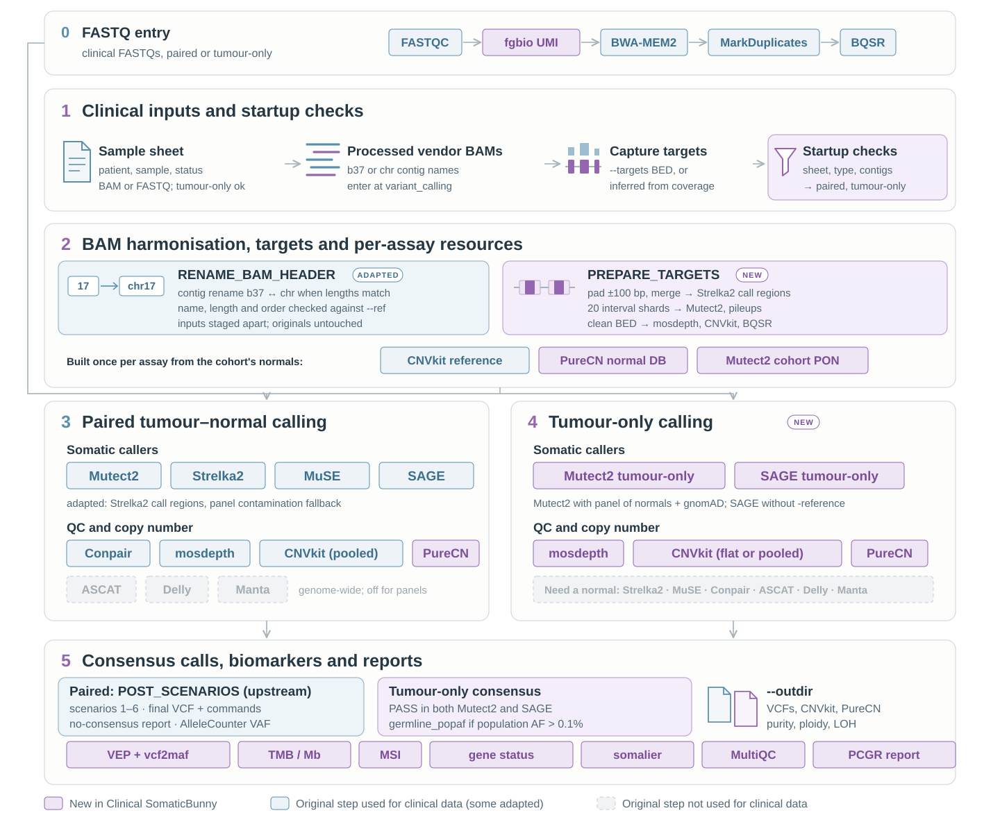

# clinicalSomaticBunny

**clinicalSomaticBunny** adapts the SomaticBunny ensemble somatic-calling pipeline to **clinical panel
sequencing**: vendor-processed BAMs or FASTQs, small capture panels, patients with or without a matched normal,
and the biomarkers a clinical collaborator expects (TMB, MSI, purity/ploidy/LOH, identity QC, PCGR report).

> **clinicalSomaticBunny is an extension of the existing [SomaticBunny](https://github.com/AlexandrovLab/SomaticBunny)
> pipeline developed by George Wu and Ting Yang at the Alexandrov Lab (UC San Diego).** All core variant calling
> and consensus logic is theirs; this branch builds on it for clinical use. All validation here uses simulated
> reads on public GRCh38 - no patient data.



## Quick start

```bash
git clone https://github.com/ammalabbasi/clinicalSomaticBunny.git
cd clinicalSomaticBunny
# needs Nextflow >= 25.04 + conda; reference database as for SomaticBunny (see docs/installation.md)

nextflow run main.nf -profile conda \
    --sample samples.csv --outdir RESULTS \
    --type panel --targets assay_targets.bed \
    --genome GRCh38 --first_step variant_calling \
    --database_path /path/to/EVC_nextflow
```

The sample sheet mixes paired, tumour-only and normal-only patients freely:

```csv
patient,sample,status,bam,bai
P01,A,normal,P01_N.bam,P01_N.bam.bai
P01,A,tumor,P01_T.bam,P01_T.bam.bai
P02,A,tumor,P02_T.bam,P02_T.bam.bai
POOL1,A,normal,N1.bam,N1.bam.bai
```

`P02` has no normal row, so it runs tumour-only natively; `POOL1` is normal-only and feeds the per-assay
resources (PON, PureCN normal DB, MSI baseline).

## Running panel data: the modes

**1 - Paired panel BAMs** (the quick start above). Calling is restricted to the padded targets; ASCAT/Delly are
refused for panels; a panel Conpair failure retries once, then skips.

**2 - Tumour-only patients.** Nothing extra: any patient without a normal row runs Mutect2 (panel-of-normals +
gnomAD) and SAGE, with a PASS-in-both consensus and population-frequency germline flagging.

**3 - No target BED?** Infer one from a few BAMs of the same assay, then run as mode 1:

```bash
sbatch targets_from_coverage/infer_targets.sbatch   # keeps bases >= 20x in half the samples
```

**4 - Vendor BAMs on b37-style contigs** (1, 2, MT) against a chr-named database:

```bash
nextflow run main.nf ... --contig_rename auto      # length-checked rename; order verified against --ref
```

**5 - FASTQs with UMIs** (deep panels): align from scratch and collapse UMI families instead of MarkDuplicates:

```bash
nextflow run main.nf ... --first_step mapping --umi --umi_read_structure "8M+T 8M+T"
```

**6 - Biomarkers, per-assay resources and the clinical report.** A pilot run builds the assay's resources from
its own normals; full runs reuse them:

```bash
# pilot: builds the cohort PON, the PureCN normal DB and the MSI baseline (>= 20 normals recommended)
nextflow run main.nf ... --tool cnvkit,purecn,tmb,msi,vep,somalier,pcgr \
    --mutect2_cohort_pon build --somalier_sites targets \
    --vep_cache /path/to/vep_cache --pcgr_env ... --pcgr_refdata ... --pcgr_vep_dir ...

# full runs: reuse what the pilot built
nextflow run main.nf ... --tool cnvkit,purecn,tmb,msi,vep,somalier,pcgr \
    --mutect2_pon PON.vcf.gz --purecn_normaldb normalDB.rds \
    --msi_baseline msi_baseline.tsv --msi_sites msi_sites.tsv
```

Cohorts with no normals at all (e.g. CARIS-style archives) run tumour-only with `--cnvkit_reference auto`
(flat reference) and the database PON; see [docs/clinical-panels.md](docs/clinical-panels.md).

## Documentation

| Page | Contents |
|---|---|
| [docs/installation.md](docs/installation.md) | prerequisites, install, configuration, running on other SLURM clusters |
| [docs/usage.md](docs/usage.md) | general usage, entry points, custom references, advanced options, outputs |
| [docs/clinical-panels.md](docs/clinical-panels.md) | the full clinical reference: every panel/tumour-only feature, biomarker tools, parameters and caveats |
| [docs/tools.md](docs/tools.md) | every tool package, pinned version and what it is used for |
| [docs/example-output.md](docs/example-output.md) | the full output folder of a synthetic run, annotated, with real example tables |
| [docs/benchmark.md](docs/benchmark.md) | synthetic validation results and the nf-core/sarek comparison |

## Output

One folder per tool under `--outdir` (consensus VCFs with their generating commands in the header, CNVkit/PureCN,
TMB/MSI tables, MAFs, somalier, MultiQC, PCGR reports) plus `REPORT/` with run-level tables
(`consensus_status.tsv`, `identity_flags.tsv`). See the annotated example in [docs/example-output.md](docs/example-output.md).

> On real data, PCGR reports and most outputs are patient-level clinical results: keep `--outdir` on a protected
> filesystem and never commit or share them.
