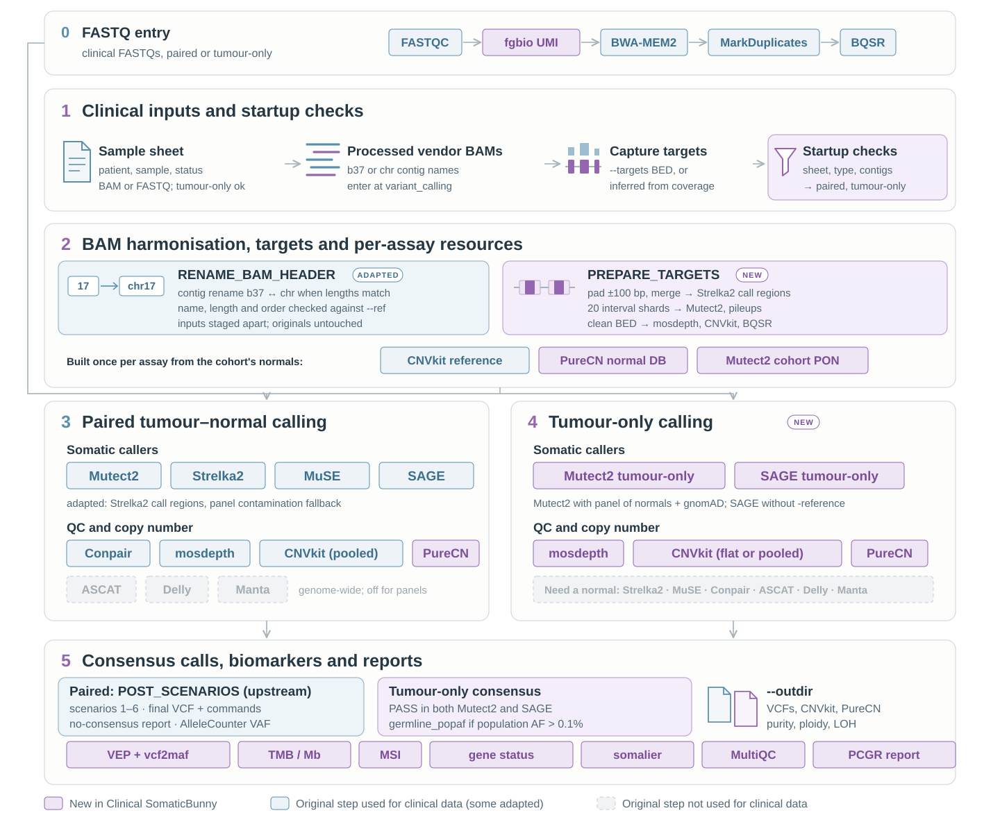

# Installation and configuration

[&larr; back to the main README](../README.md)

## What the pipeline is

clinicalSomaticBunny builds on SomaticBunny, which integrates multiple variant calling tools to improve detection accuracy for:
- Single Nucleotide Variants (SNVs)
- Insertions and Deletions (INDELs)
- Structural Variants (SVs)
- Copy Number Variants (CNVs)

The original pipeline was designed for paired tumour-normal whole-genome or whole-exome data; **clinicalSomaticBunny** extends it to targeted panels, tumour-only patients and vendor-processed BAMs (see [clinical-panels.md](clinical-panels.md)).

<p align="center">
  
</p>

## Prerequisites

- Conda/Mamba for environment management
- A SLURM cluster is recommended for WGS data (see [Choosing Where Jobs Run](#choosing-where-jobs-run))

## Installation

1. Clone this repository

2. Install [Nextflow](https://www.nextflow.io/docs/latest/install.html) as a conda environment

3. Make sure you have the following required files in your working directory:
   - `main.nf`
   - `nextflow.config`
   - `conf/base.config`
   - `sample.csv`

4. Prepare your `sample.csv` file according to your analysis requirements:

   <details>
   <summary><b>For starting from fastq (click to expand)</b></summary>
   
   ```csv
   patient,sample,status,fastq_1,fastq_2
   UCSD101,A,normal,/PATH/TO/ERR5285401_1.fastq.gz,/PATH/TO/ERR5285401_2.fastq.gz
   UCSD101,A,tumor,/PATH/TO/ERR5285402_1.fastq.gz,/PATH/TO/ERR5285402_2.fastq.gz
   UCSD101,B,tumor,/PATH/TO/ERR5285403_1.fastq.gz,/PATH/TO/ERR5285403_2.fastq.gz
   ```
   </details>
   <details>
   <summary><b>For starting from bams (click to expand)</b></summary>
   
   ```csv
   patient,sample,status,bam,bai,sex
   UCSD101,A,normal,/PATH/TO/UCSD101_A_normal.bam,/PATH/TO/UCSD101_A_normal.bam.bai,XY
   UCSD101,A,tumor,/PATH/TO/UCSD101_A_tumor.bam,/PATH/TO/UCSD101_A_tumor.bam.bai,XY
   UCSD101,B,tumor,/PATH/TO/UCSD101_B_tumor.bam,/PATH/TO/UCSD101_B_tumor.bam.bai,XY
   ```
   </details>

   <details>
   <summary><b>For ASCAT analysis (click to expand)</b></summary>
   
   ```csv
   patient,sample,status,fastq_1,fastq_2,sex
   UCSD101,A,normal,/PATH/TO/ERR5285401_1.fastq.gz,/PATH/TO/ERR5285401_2.fastq.gz,XY
   UCSD101,A,tumor,/PATH/TO/ERR5285402_1.fastq.gz,/PATH/TO/ERR5285402_2.fastq.gz,XY
   UCSD101,B,tumor,/PATH/TO/ERR5285403_1.fastq.gz,/PATH/TO/ERR5285403_2.fastq.gz,XY
   ```
   </details>

  > [!NOTE]
  > **One FASTQ pair per sample.** `sample.csv` takes exactly one `fastq_1`/`fastq_2` pair per
  > sample. If a sample was sequenced on several lanes or runs, concatenate the lanes into one
  > pair before running the pipeline. Each BAM therefore carries a single read group:
  > `ID`, `SM` and `LB` are `<patient>_<sample>_<status>`, `PL` is `ILLUMINA`, and `PU` is the
  > flowcell and lane of the first read (or the sample name if the read names are not in the
  > Illumina format). Because merged lanes share one read group, base quality score
  > recalibration models one error profile per sample rather than per lane.
  > bwa-mem2 runs with `-Y` (soft-clipped supplementary alignments) and a fixed batch size
  > `-K 160000000`, so alignments do not depend on the number of CPUs assigned.

## Configuration

For memory management, modify the following parameters if needed:

- Set `$params.mkdup_temp_dir` in `main.nf` to your ideal location (Default: `$projectDir/mkdup_tmp`)
- Set `$workDir` in `nextflow.config` to your ideal location (Default: `./work`)

```nextflow
// In main.nf
params.mkdup_temp_dir = "/path/to/ideal/mkdup_tmp/folder/"

// In nextflow.config
workDir = "/path/to/ideal/intermediate/work/folder/"
```

## Choosing Where Jobs Run

Use `-profile` (one dash, it is a Nextflow option) to choose the scheduler, combined with `conda` for the software. Profiles are separated by a comma, with no space.

| Profile | Runs on |
|---------|---------|
| `tscc_slurm,conda` | UCSD TSCC: each job is submitted to SLURM with the lab's partition, QoS and account |
| `slurm,conda` | Any SLURM cluster: each job is submitted to SLURM with the cluster's defaults, or with your own options (see below) |
| `conda` | The current machine only (no scheduler) |

> [!WARNING]
> Without `tscc_slurm` or `slurm`, all jobs run on the machine where Nextflow is started, which is not practical for WGS data.

### Running on other SLURM clusters

If your cluster needs a partition, account or QoS, put them in a small config file of your own and pass it with `-c`. You don't need to edit SomaticBunny's `nextflow.config`, so your settings are kept when you update the pipeline.

1. Create `my_cluster.config` (any name works):

```groovy
// my_cluster.config
process.clusterOptions = '-p <partition> -A <account>'
```

2. Run with the `slurm` profile and your config:

```bash
nextflow run main.nf -profile slurm,conda -c my_cluster.config --type genome ...
```

`process.clusterOptions` is passed to every job as extra `sbatch` options, so anything `sbatch` accepts works, e.g. `'--partition=compute --account=mylab --qos=normal'`.

If your nodes are smaller than the default requests (up to 16 CPUs and 250 GB for some steps), cap what any job can request:

```bash
nextflow run main.nf -profile slurm,conda -c my_cluster.config --max_cpus 32 --max_memory 192.GB --max_time 72.h ...
```

### Software

SomaticBunny installs its tools with Conda (`-profile conda`, or `-profile mamba` for faster environment creation). Container engines such as Docker and Singularity are not supported.
